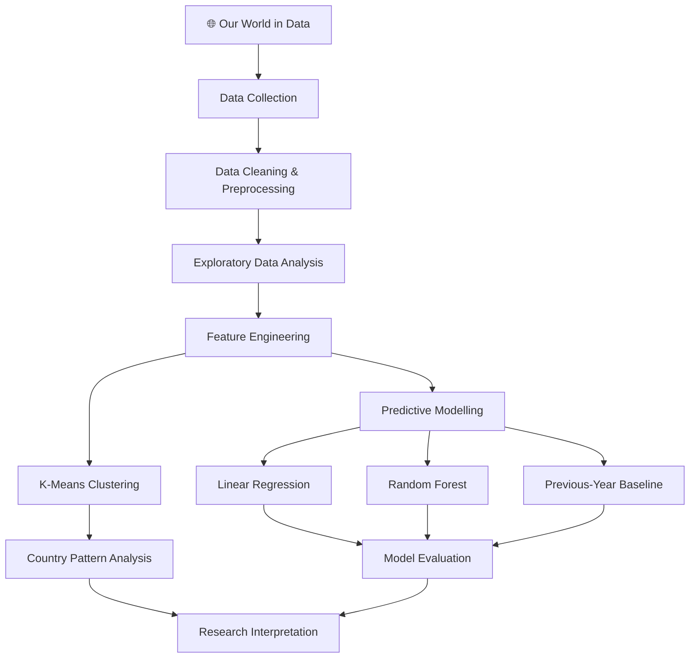

# 🌍 GREEN MIRAGE 2.0

<div align="center">

### GLOBAL ENERGY TRANSITION INTELLIGENCE SYSTEM

**Beyond Renewable Growth. Understanding the Energy Transition.**

<br>

[](https://python.org/)
[](https://pandas.pydata.org/)
[](https://scikit-learn.org/)
[](https://jupyter.org/)

<br>

**DATA SCIENCE · MACHINE LEARNING · ENERGY ANALYTICS · CLIMATE RESEARCH**

</div>

---

## 🔎 THE RESEARCH QUESTION

> **Are countries genuinely transitioning away from fossil fuels, or are renewable energy sources simply expanding alongside growing energy demand?**

Renewable energy is expanding across the world. But does increasing renewable energy adoption necessarily mean that fossil fuel dependence is declining?

**Green Mirage 2.0** investigates this question through historical energy data, statistical analysis, country-level comparisons, and machine learning.

The goal is to look beyond renewable energy growth and explore what is actually happening within the global energy landscape.

---

## ⚡ PROJECT OVERVIEW

| Component | Description |
|:---|:---|
| 🌱 Energy Analytics | Renewable and fossil fuel trend analysis |
| 🌎 Country Comparison | Five-country comparative case study |
| 🧮 Feature Engineering | Derived energy-transition indicators |
| 🧩 Clustering | K-Means country segmentation |
| 🤖 Prediction | Next-year renewable energy share modelling |
| 📊 Evaluation | MAE, RMSE and R² |

---

## 🌍 COUNTRIES UNDER INVESTIGATION

The comparative case study focuses on five countries with different energy profiles and geographical contexts.

| Country | Region |
|:---|:---|
| 🇮🇳 India | Asia |
| 🇨🇳 China | Asia |
| 🇩🇪 Germany | Europe |
| 🇧🇷 Brazil | South America |
| 🇺🇸 United States | North America |

The clustering and predictive workflows also consider other eligible countries with sufficient observations.

---

## 🧠 ANALYTICAL FRAMEWORK

The project follows a multi-stage analytical pipeline.



### 01 — Data Collection & Preprocessing

- Historical country-level energy observations.
- Missing-value inspection and treatment.
- Duplicate removal and data type conversion.
- Preparation of country-year datasets.

### 02 — Exploratory Data Analysis

Investigating:

- Renewable energy share trends.
- Fossil fuel energy share trends.
- Energy consumption patterns.
- Country-level differences.
- Changes in energy growth over time.

### 03 — Feature Engineering

Developing additional indicators to investigate energy-transition patterns:

- Renewable-to-fossil share gap.
- Renewable-to-fossil share ratio.
- Per-capita energy consumption.
- GDP per capita, where available.
- Year-over-year growth.

### 04 — Unsupervised Learning

**K-Means Clustering**

Identifying groups of countries with similar energy characteristics.

Techniques:
- Feature scaling.
- Missing-value imputation.
- Cluster selection analysis.
- Principal Component Analysis (PCA).

### 05 — Supervised Learning

Exploring next-year renewable energy share prediction using:

| Model | Purpose |
|:---|:---|
| Linear Regression | Linear prediction baseline |
| Random Forest Regression | Nonlinear prediction |
| Previous-Year Baseline | Persistence comparison |

### 06 — Model Evaluation

Model performance is examined using:

- Mean Absolute Error (MAE)
- Root Mean Squared Error (RMSE)
- Coefficient of Determination (R²)

A chronological train-test split is used to evaluate performance on later target years.

---

## 📊 VISUAL RESEARCH OUTPUTS

The repository includes visualizations generated during the analysis.

Add your actual chart previews below:

| Analysis | Visualization |
|:---|:---|
| Global energy trends | `visualizations/your_chart.png` |
| Country comparison | `visualizations/your_chart.png` |
| Energy transition clustering | `visualizations/your_chart.png` |
| Model evaluation | `visualizations/your_chart.png` |

*Replace these example paths with the actual chart filenames.*

---

## 🛠️ TECHNOLOGY STACK

| Tool | Application |
|:---|:---|
| Python | Core programming |
| Pandas | Data manipulation |
| NumPy | Numerical operations |
| Matplotlib | Data visualization |
| Seaborn | Statistical visualization |
| Scikit-learn | Machine learning |
| Google Colab | Development |
| GitHub | Version control |

---

## 📁 PROJECT ARCHITECTURE

```text
GREEN-MIRAGE-2.0/
│
├── 📄 README.md
├── 📄 requirements.txt
│
├── 📂 notebooks/
│   └── Green_Mirage_2.0.ipynb
│
├── 📂 visualizations/
│   └── Research charts and figures
│
└── 📂 results/
    └── Exported CSV files
```

---

## 📚 DATA SOURCE

**Our World in Data — Energy**

https://ourworldindata.org/energy

The project uses historical energy indicators to investigate country-level energy patterns.

---

## 🔭 FUTURE DIRECTIONS

Potential extensions of this research include:

- Investigating absolute fossil fuel consumption alongside renewable energy growth.
- Expanding the analysis to additional countries.
- Incorporating more economic and environmental indicators.
- Exploring longer-term forecasting techniques.
- Developing an interactive energy-transition intelligence dashboard.

---

## ⚠️ RESEARCH LIMITATIONS

- Historical patterns do not guarantee future outcomes.
- Data availability differs between countries.
- Clustering results depend on feature selection and preprocessing.
- Predictive performance must be interpreted using the evaluation results.
- Feature importance does not establish causation.
- Renewable energy share growth alone does not establish a reduction in absolute fossil fuel consumption.

---

<div align="center">

## 🌱 THE IDEA BEHIND GREEN MIRAGE

*Is the world replacing fossil fuels, or simply adding more energy sources to an expanding energy system?*

**Looking beyond the numbers. Understanding the transition.**

</div>

---

**Project:** Green Mirage 2.0  
**Domain:** Data Science · Energy Analytics · Machine Learning  
**Language:** Python  
**Dataset:** Our World in Data

